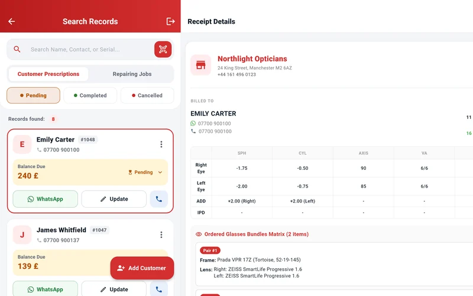
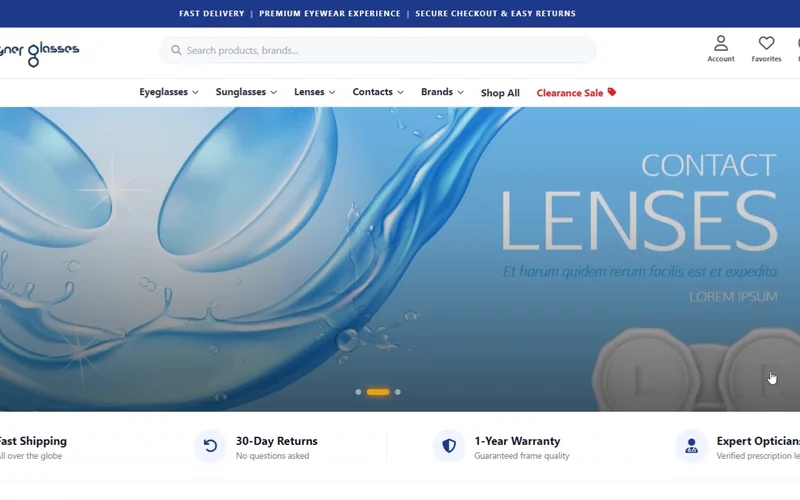
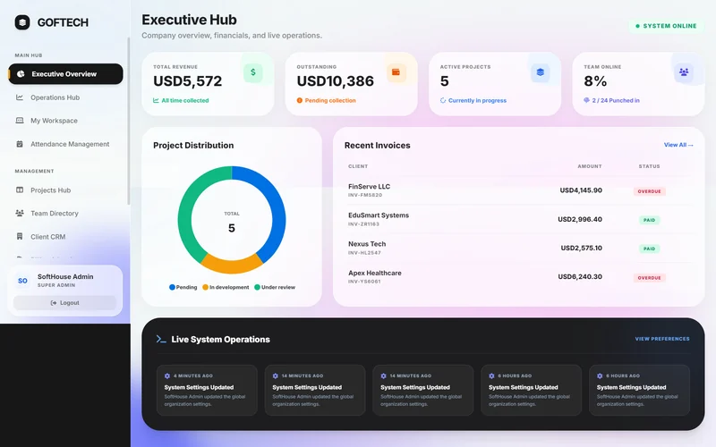
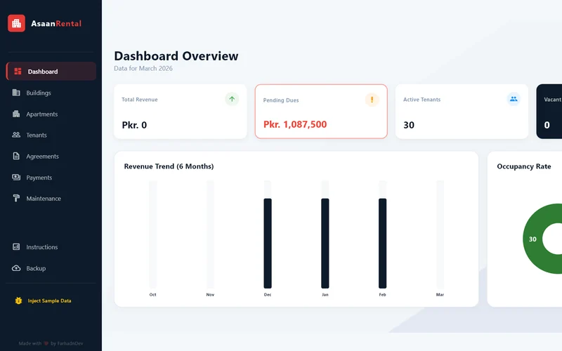
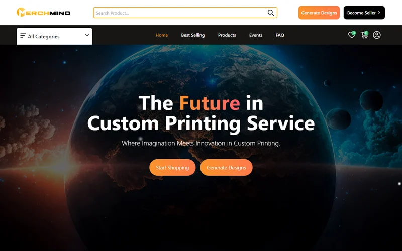
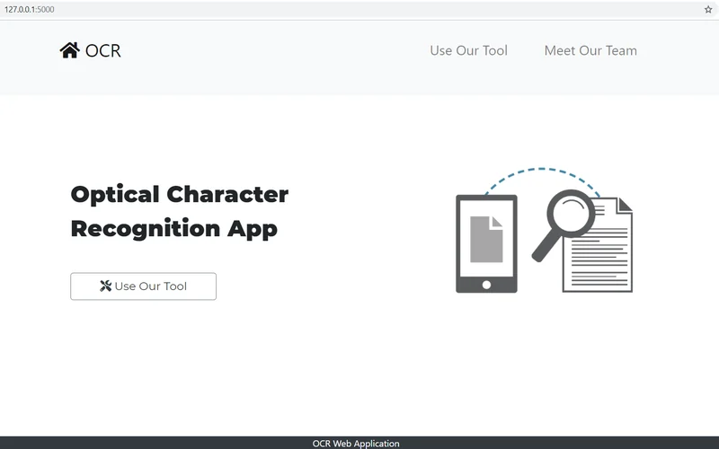
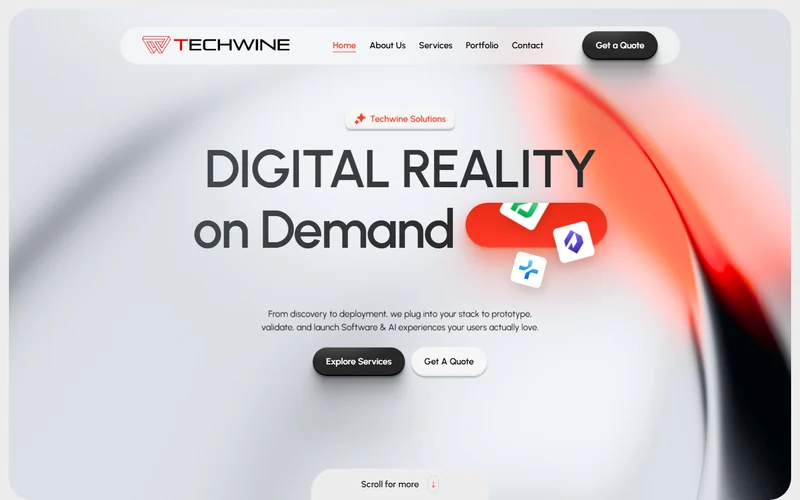

<h1 align="center">Hi 👋, I'm Farhad Nazir</h1>
<h3 align="center">Software Engineer | Full-Stack Developer (Flutter & Laravel) | Founder @ Techwine Solutions</h3>

<table>
  <tr>
    <td width="65%" valign="top">
      <h2>💫 About Me:</h2>
      🔭 I’m building and scaling my flagship product, <b>Asaan Optics</b>, a POS and shop management system used by <b>800+ active retail businesses</b>. It now runs on <b>Android phones, tablets and Chromebooks, Windows desktop</b>, and is coming to <b>iPhone & iPad</b>, in <b>9 languages</b> including Arabic and Urdu.  
      🌱 I’m deeply focused on advanced <b>Flutter architectures</b> for cross-platform apps (mobile, tablet and desktop) and on robust web ecosystems with <b>Laravel</b> and <b>Node.js</b>.  
      👯 I’m looking to collaborate on impactful SaaS products and real-world desktop/mobile applications.  
      👨‍💻 All of my projects are available at <a href="https://github.com/farhadnazir/">github.com/farhadnazir</a>  
      💬 Ask me about <b>Flutter, Dart, Laravel, PHP, Node.js, RESTful APIs, offline-first databases (SQLite), e-invoicing (ZATCA) and app store releases</b>.  
      📫 How to reach me: <b>farhadnazir1111@gmail.com</b>  
      ⚡ Fun fact: Aside from writing clean code, I am also a superb Video Editor!
    </td>
    <td width="35%" align="center" valign="middle">
      
    </td>
  </tr>
</table>

## 🚀 Highlighted Projects:

<table>
  <tr>
    <td width="50%" valign="top">
      
      <h3>👓 <a href="https://github.com/farhadnazir/Asaan-Optics-App-Official">Asaan Optics</a></h3>
      Cross-platform POS for optical shops: prescriptions, sales, repairs, stock, branches, ZATCA e-invoicing, eye screening and an offline AI helper. <b>800+ businesses, 50,000+ patient records.</b> 
      Flutter • Node.js • TiDB/MySQL • Firebase • ML Kit • GitHub Actions + fastlane 
      <a href="https://asaanoptics.com">Website</a> • <a href="https://play.google.com/store/apps/details?id=com.techwinesolutions.asaanoptics">Google Play</a>
    </td>
    <td width="50%" valign="top">
      
      <h3>🖥️ <a href="https://github.com/farhadnazir/Asaan-Optics-App-Official#%EF%B8%8F-windows-desktop-software">Asaan Optics Desktop</a></h3>
      The Windows back office of Asaan Optics: point of sale, frames/lenses/contact lens inventory, stock control center, My Branches, close shift and Saudi e-invoicing, synced with the mobile app. 
      Flutter Windows • SQLite • REST API 
      <a href="https://asaanoptics.com/download.html">Download</a>
    </td>
  </tr>
  <tr>
    <td width="50%" valign="top">
      
      <h3>🛍️ <a href="https://github.com/farhadnazir/Next-Gen-Eyewear-E-Commerce-and-ERP">Next-Gen Eyewear E-Commerce & ERP</a></h3>
      Eyewear store with a lens engine (Rx, lens types and add-ons), contact lens volume pricing, variant stock and an admin command center. 
      Laravel • Livewire • Tailwind CSS • MySQL
    </td>
    <td width="50%" valign="top">
      
      <h3>🧑🏻‍💻 <a href="https://github.com/farhadnazir/Advance-ERP-System---Software-House-Task-Management">GOFTECH Workspace & ERP</a></h3>
      ERP for a software house: Kanban projects, real-time time tracking, HRMS with attendance and leaves, CRM and invoicing. 
      Laravel • Livewire • Alpine.js • Tailwind CSS • MySQL
    </td>
  </tr>
  <tr>
    <td width="50%" valign="top">
      
      <h3>🏢 <a href="https://github.com/farhadnazir/Asaan_rental_app">Rental Pro</a></h3>
      Offline-first desktop app for property managers: buildings, apartments, tenants, agreements, rent and automatic Google Drive backups. 
      Flutter • SQLite • Google Drive API
    </td>
    <td width="50%" valign="top">
      
      <h3>🎨 <a href="https://github.com/farhadnazir/MerchMind-AI-Platform">MerchMind AI</a></h3>
      AI-powered custom printing and merch marketplace: generate designs with AI, shop, sell and pay online. 
      React • Redux • Node.js • Express • MongoDB • Gemini/OpenAI • Stripe 
      <a href="https://merchmind.netlify.app">Live demo</a>
    </td>
  </tr>
  <tr>
    <td width="50%" valign="top">
      
      <h3>🔎 <a href="https://github.com/farhadnazir/IntelliScan">IntelliScan OCR</a></h3>
      Web app that extracts text from images, with noise removal and morphological clean-up to get the best result. 
      Python • Flask • Tesseract • OpenCV
    </td>
    <td width="50%" valign="top">
      
      <h3>🏷️ <a href="https://www.techwinesolutions.com">Techwine Solutions</a></h3>
      My software company: custom software, mobile apps, AI products and digital solutions for businesses. 
      Website: <a href="https://www.techwinesolutions.com">techwinesolutions.com</a>
    </td>
  </tr>
</table>

**More work:** **Track Cue**, a snooker club management and billing system (Laravel) • **GeoPrints**, a privacy-first travel journal and location tracker (Flutter), [see it here](https://www.techwinesolutions.com/geoprintsapp).

## 🌐 Socials:
   

<picture>
  <source media="(prefers-color-scheme: dark)" srcset="https://raw.githubusercontent.com/platane/snk/output/github-contribution-grid-snake-dark.svg" />
  <source media="(prefers-color-scheme: light)" srcset="https://raw.githubusercontent.com/platane/snk/output/github-contribution-grid-snake.svg" />
  
</picture>

# 💻 Tech Stack:

**Mobile & Desktop:**
     

**Backend & Web:**
           

**Databases & Tools:**
        

**Design & Editing:**
  

---

  
    

### ✍️ Random Dev Quote

