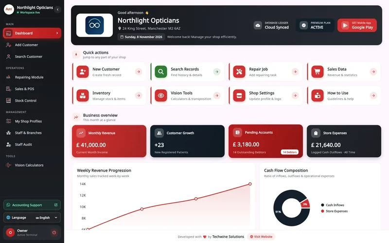

<h1 align="center">Hi, I'm Farhad Nazir 👋</h1>

<b>Full-stack software developer</b> · Founder of <a href="https://www.techwinesolutions.com">Techwine Solutions</a> · Riyadh, Saudi Arabia

  
  
  
  

<table>
  <tr>
    <td width="65%" valign="top">
      <h3>About me</h3>
      
I design and build web applications, SaaS platforms, Flutter mobile apps and Windows desktop software, from system architecture through to production.

      
My flagship product is <a href="https://asaanoptics.com"><b>Asaan Optics</b></a>, optical shop software for Android and Windows that I founded and build on my own. Through my company Techwine Solutions I also build client systems such as online stores, ERPs and marketplaces.

      
Ask me about <b>Flutter</b>, <b>Laravel and Livewire</b>, <b>Node.js</b>, REST APIs, offline-first apps with SQLite, ZATCA e-invoicing and shipping apps to Google Play and the App Store.

      
Case studies, screenshots and contact details: <a href="https://farhadnazir.com"><b>farhadnazir.com</b></a>

    </td>
    <td width="35%" align="center" valign="middle">
      
    </td>
  </tr>
</table>

## Featured work

### [Asaan Optics](https://farhadnazir.com/projects/asaan-optics/)

Optical shop software for Android and Windows: prescriptions, counter sales, stock and staff shifts on one shared shop account. Available in nine languages, including Arabic and Urdu, with Saudi VAT receipts and ZATCA Phase 2 e-invoicing built into the Windows app. Founder and sole developer.

<table>
  <tr>
    <td width="50%"></td>
    <td width="50%"></td>
  </tr>
</table>

Flutter · Dart · Node.js · Express · MySQL (TiDB) · SQLite · Firebase · Google ML Kit · GitHub Actions 
[Website](https://asaanoptics.com) · [Case study](https://farhadnazir.com/projects/asaan-optics/) · [Google Play](https://play.google.com/store/apps/details?id=com.techwinesolutions.asaanoptics) · [Windows download](https://asaanoptics.com/download) · [Video tutorials](https://www.youtube.com/playlist?list=PLI9xnOxtXgaE) · [Showcase repo](https://github.com/farhadnazir/Asaan-Optics-App-Official)

### More case studies

| Project | What it is | Status | Built with |
|---|---|---|---|
| [**KAYANAK**](https://farhadnazir.com/projects/kayanak/) | Arabic-first car marketplace and sales CRM for a Riyadh car business, with installment pricing, car-wash booking and an AI sales assistant. Lead full-stack developer and DevOps. | Live | NestJS, Next.js, PostgreSQL, Prisma, Flutter |
| [**Estasher**](https://farhadnazir.com/projects/estasher/) | Bilingual iOS and Android marketplace where clients in Saudi Arabia book consultations and request offers from verified engineers and engineering offices. | Live on iOS and Android | Flutter, Firebase, PHP, MySQL |
| [**Faisal Optical Service**](https://farhadnazir.com/projects/faisal-optical-service/) | Online eyewear store with a step-by-step prescription lens configurator and a full admin back office. | Live | Laravel, Livewire, MySQL, Tailwind CSS |
| [**Shehmina's Wardrobe**](https://farhadnazir.com/projects/shehminas-wardrobe/) | E-commerce for a womenswear label, with made-to-measure tailoring options and a full admin back office. | Working prototype | Laravel, Livewire Volt, Tailwind CSS |
| [**CampusPro**](https://farhadnazir.com/projects/campuspro/) | Multi-tenant management platform for schools, colleges and academies. I audited and hardened it for security, tenant isolation and data integrity. | In development | ASP.NET Core, EF Core, PostgreSQL, React |
| [**Caption AI**](https://farhadnazir.com/projects/caption-ai/) | Captioning web app for South Asian video creators, with Gemini transcription and a full caption editor. Built in a team of three. | In development | Node.js, React, TypeScript, Gemini, FFmpeg |
| [**Designers Glasses**](https://farhadnazir.com/projects/designers-glasses/) | Online eyewear store with a prescription lens configurator, contact lens shop and admin back office, delivered through Techwine Solutions. | Live | Laravel, Livewire, MySQL, Tailwind CSS |

All case studies: **[farhadnazir.com/projects](https://farhadnazir.com/projects/)**

### Public repositories

- [Asaan Rental Pro](https://github.com/farhadnazir/Asaan_rental_app): offline Windows desktop app for landlords (Flutter, SQLite). [Download v1.0.0](https://github.com/farhadnazir/Asaan_rental_app/releases/tag/v1.0.0)
- [SoftHouse Pro ERP](https://github.com/farhadnazir/Advance-ERP-System---Software-House-Task-Management): Laravel and Livewire ERP for software houses, with Kanban, time tracking, attendance, invoicing and a client portal
- [Designers Glasses overview](https://github.com/farhadnazir/Next-Gen-Eyewear-E-Commerce-and-ERP): public overview of the eyewear store and admin ERP
- [Asaan Optics showcase](https://github.com/farhadnazir/Asaan-Optics-App-Official): screenshots, features and downloads for Asaan Optics
- [Techwine (first website)](https://github.com/farhadnazir/techwine): the first Techwine Solutions website, built with React and Vite

## Tech stack

**Mobile and desktop** 

**Backend** 

**Frontend** 

**Data and delivery** 

## GitHub activity

  <picture>
    <source media="(prefers-color-scheme: dark)" srcset="https://streak-stats.demolab.com/?user=farhadnazir&theme=dark&hide_border=true&background=0D1117" />
    
  </picture>

<picture>
  <source media="(prefers-color-scheme: dark)" srcset="https://raw.githubusercontent.com/farhadnazir/farhadnazir/output/github-snake-dark.svg" />
  <source media="(prefers-color-scheme: light)" srcset="https://raw.githubusercontent.com/farhadnazir/farhadnazir/output/github-snake.svg" />
  
</picture>

## Get in touch

For projects and enquiries:

- Website: [farhadnazir.com](https://farhadnazir.com)
- Email: [farhadnazirksa@gmail.com](mailto:farhadnazirksa@gmail.com)
- LinkedIn: [linkedin.com/in/farhadnazir](https://www.linkedin.com/in/farhadnazir)
- WhatsApp: [+966 53 656 6380](https://wa.me/966536566380)
- Company: [Techwine Solutions](https://www.techwinesolutions.com)

  <picture>
    <source media="(prefers-color-scheme: dark)" srcset="assets/brand/farhad-nazir-signature-white.svg" />
    
  </picture>

